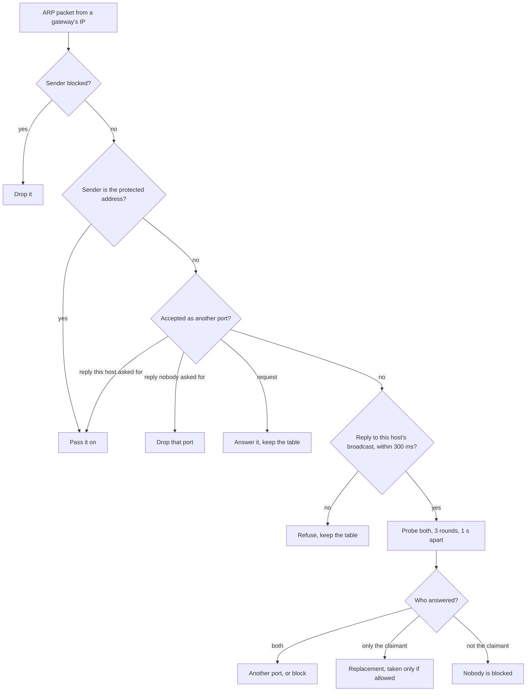

# jollaman999 ubuntu-kernel

[한국어 문서](docs/README.ko.md)

The Ubuntu 26.10 (stonking) kernel with **arp_project** on top.

| | |
|---|---|
| Base | Ubuntu `linux 7.3.0-10.10` (stonking-proposed), upstream `v7.3` |
| Ubuntu patches | everything up to `7.3.0-12.13` (stonking master-next, not tagged yet) |
| upstream stable | `v7.3.5` |
| Package version | `7.3.0-24.24`, so `uname -r` says `7.3.0-24-generic` |
| Older line | the 7.2.x work is kept on the `linux-7.2` branch, ending at `7.2.3-11.11` |
| Added | arp_project 3.0 |

## arp_project

It keeps the gateways the routes go through from being moved to somebody
else's hardware address: the default route's, and every other route's too,
following the routing table. Each gateway address is pinned down and any
attempt to move it is refused. A claim that answers this host's own question
for the gateway is then checked with unicast ARP probes, which tell a live
attack apart from a gateway that is really gone. Even a proven replacement
is taken only with `allow_gw_hwaddr_change` set, and that is `0` by default,
so after a real router swap write `1` to `clear_gw_hwaddr` to learn the new
one.

The knobs live in `/sys/kernel/arp_project/`. `cat how_to_use` prints the
manual; `how_to_use_ko` is the Korean one.

A gateway that does not answer from a single hardware address (an HA pair, a
bonded link) is handled by `allow_multi_gw_hwaddr`. At the default `1`, a
second address that answers a unicast probe sent to it is accepted as another
port of the same gateway; at `0`, that second answer is treated as an attack
and blocked. Only a reply to a request this host sent is heard, and a second
port that replies unasked is dropped again.

### How it works

1. **Find the gateways.** Whenever a route is added or removed,
   arp_project reads the routing table and keeps a record for every IPv4
   gateway a route goes through, on each device. That covers the default
   route, every other route, and a backup route that is not in use yet.
   Nothing that arrives on the wire can add a record.
2. **Learn each gateway's address.** The first time a gateway is resolved,
   its hardware address becomes the protected address. It comes from the
   ARP table if that already holds a valid entry, and otherwise from the
   reply that resolves the gateway. From then on it is pinned.
3. **Check every ARP packet from a gateway's IP address** before it can
   change the ARP table. The protected address passes. A blocked address is
   dropped. Any other address claiming the gateway is refused, and the ARP
   table keeps the protected address. Only one kind of claim is looked at
   further: a reply to the broadcast request this host sent for the
   gateway, addressed to this host, arriving within 300 ms.
4. **Verify that claim.** Three times, a second apart, this host sends a
   unicast ARP request for the gateway to the protected address and
   another to the claimant. A unicast frame reaches only the host it is
   addressed to, so nobody else can answer in its place. The rounds run on
   a timer, so the verdict comes about three seconds later even if the
   claimant goes quiet. Until then the claimant is refused and the ARP
   table does not change.
5. **Act on who answered.**

   | Who answered | What it means | What happens |
   |---|---|---|
   | both | one gateway with two ports, or an attacker beside a live gateway | accepted as another port with `allow_multi_gw_hwaddr` `1` (default), blocked with `0` |
   | only the claimant | the protected address is gone | the new address is taken only with `allow_gw_hwaddr_change` `1`. At the default `0` it is refused and logged |
   | not the claimant | the packet named somebody else | nobody is blocked |

   A claimant that did not answer, or whose replacement was refused, is
   not verified again for 60 seconds. It stays refused during that time.
6. **Undo it by hand when needed.** Up to 16 blocked addresses are kept for
   the whole machine, and the oldest one makes way for a new one. A block
   lasts until it is cleared, or for `attacker_timeout` seconds if that is
   set. `clear_attacker_hwaddr` unblocks every address.
   `clear_gw_hwaddr` forgets the protected addresses so they are learnt
   again. Use it after a real router swap, or when the host booted while an
   attack was already running.



Full documentation:

- `Documentation/networking/arp_project.rst`
- `Documentation/translations/ko_KR/networking/arp_project.rst`

## How this differs from the stock Ubuntu kernel

### zfs is built here

Ubuntu makes `linux-modules` `Depends` on `linux-main-modules-zfs-<version>`.
Ubuntu builds that package from a separate source package against its own
ABI, so its build never matches a kernel built here. This tree builds the
package itself instead, and the dependency stays as Ubuntu has it.

Ubuntu makes this a `Depends` rather than a `Recommends` for a reason. The
installer offers root-on-ZFS, and such a system will not boot at all if the
kernel has no `zfs.ko`.

- The source is `zfs-dkms_2.4.4-1ubuntu3_all.deb`, downloaded during the
  build from Launchpad or, failing that, from the apt sources on the build
  host. The version is set by `dkms_zfs_debpath` in
  `debian/rules.d/0-common-vars.mk`; change it there to move zfs forward.
- The modules go to `/usr/lib/modules/7.3.0-24-generic/kernel/zfs/zfs/` in
  `linux-main-modules-zfs-7.3.0-24-generic`.
- If zfs fails to build, the whole kernel build stops. To build without zfs,
  pass both of these, so that `linux-modules` does not depend on a package
  that was never built:

  ```sh
  env do_zfs=false do_linux_main_modules_depends=false ... fakeroot debian/rules binary-generic
  ```

### v4l2loopback is built here too

Since Ubuntu `7.3.0-8.8`, `linux-modules` on amd64 also `Depends` on
`linux-main-modules-v4l2loopback-<version>`, so that v4l2loopback is in the
default installation. It is built here the same way as zfs.

- The source is `v4l2loopback-dkms_0.15.3-1ubuntu2_all.deb`, set by
  `dkms_v4l2loopback_debpath` in `debian/rules.d/0-common-vars.mk`.
- The module goes to
  `/usr/lib/modules/7.3.0-24-generic/kernel/v4l2loopback/v4l2loopback/` in
  `linux-main-modules-v4l2loopback-7.3.0-24-generic`. Only amd64 builds it.
- `do_linux_main_modules_depends=false` drops this dependency together with
  the zfs one. To build without it, pass `do_v4l2loopback=false` as well.

### ccache is used automatically

If `ccache` is installed, it wraps `CC`. Turn it off with `USE_CCACHE=0`, or
point at another binary with `CCACHE=<path>`. With no ccache installed,
nothing changes.

`HOSTCC` is not wrapped, because it is passed to rustc as
`-Clinker=$(HOSTCC)` and rustc takes only the first word as the linker.

## Building

Building anywhere other than Ubuntu 26.10 is easier in a container. You need
gcc 15, rustc 1.97, clang 22 and pahole 1.29 or newer.

```sh
fakeroot debian/rules clean
env rustc=/usr/bin/rustc-1.97 do_tools=false skipabi=true skipmodule=true \
    skipdbg=true skipretpoline=true DEB_BUILD_OPTIONS=parallel=$(nproc) \
    debian/rules build-generic
env rustc=/usr/bin/rustc-1.97 do_tools=false skipabi=true skipmodule=true \
    skipdbg=true skipretpoline=true DEB_BUILD_OPTIONS=parallel=$(nproc) \
    fakeroot debian/rules binary-generic
env rustc=/usr/bin/rustc-1.97 do_tools=false skipabi=true skipmodule=true \
    skipdbg=true skipretpoline=true \
    fakeroot debian/rules binary-indep
```

`rustc=` is given because `debian.master/config/annotations` requires
`CONFIG_RUSTC_VERSION=109701`. A default `rustc` older than that stops the
config check.

`binary-indep` builds the architecture-independent header package. DKMS needs
it.

`build-generic` is run on its own, outside fakeroot. Under fakeroot every
file operation of the compile waits on the one `faked` daemon. Most CPUs sit
idle and the compile runs at about half the speed, whatever `-j` is.
`binary-generic` then only installs and packages what was built.

## Installing

```sh
sudo dpkg -i linux-modules-7.3.0-24-generic_*.deb \
             linux-main-modules-zfs-7.3.0-24-generic_*.deb \
             linux-main-modules-v4l2loopback-7.3.0-24-generic_*.deb \
             linux-image-unsigned-7.3.0-24-generic_*.deb \
             linux-headers-7.3.0-24_*.deb \
             linux-headers-7.3.0-24-generic_*.deb
```

With Secure Boot on, `linux-image-unsigned` will not boot.

### Secure Boot

This tree does not produce a signed build. Stock Ubuntu's signed kernel
(`linux-image-7.3.0-24-generic`) is made by a separate source (`linux-signed`)
that comes out of Canonical's signing service, so a kernel built here cannot
be shipped that way. To run with Secure Boot on, you have two choices.

- **Sign it yourself (MOK).** Make a key once, enrol it in the firmware, and
  sign the installed kernel image. You need `mokutil` and `sbsigntool`.

  ```sh
  openssl req -new -x509 -newkey rsa:2048 -keyout MOK.key -out MOK.crt \
      -nodes -days 36500 -subj "/CN=local kernel/"
  openssl x509 -in MOK.crt -outform DER -out MOK.der

  sudo mokutil --import MOK.der   # pick a password. On reboot the MOK
                                  # manager comes up to confirm the enrolment

  sudo sbsign --key MOK.key --cert MOK.crt \
      --output /boot/vmlinuz-7.3.0-24-generic /boot/vmlinuz-7.3.0-24-generic
  ```

  Every newly installed kernel image has to be signed again.

- **Turn Secure Boot off.** With it off in the firmware, the unsigned image
  boots as it is.
