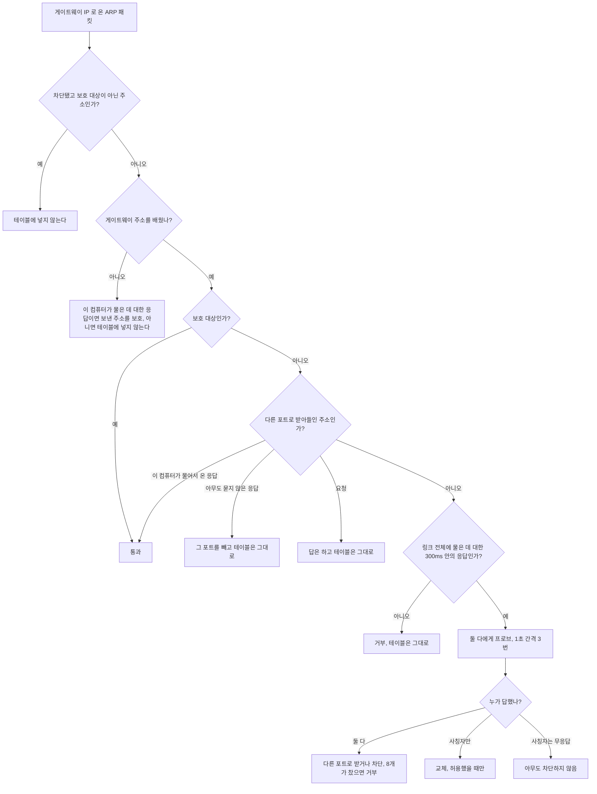

# jollaman999 ubuntu-kernel

Ubuntu 26.10 (stonking) 커널에 **arp_project** 를 얹은 트리다.

| | |
|---|---|
| 베이스 | Ubuntu `Ubuntu-7.3.0-12.13` (stonking master-next 태그), upstream `v7.3` |
| Ubuntu 패치 | `7.3.0-12.13` 의 것 전부 |
| upstream stable | `v7.3.1` 부터 `v7.3.5` 까지 하나씩 merge 커밋으로 |
| 패키지 버전 | `7.3.0-26.26` → `uname -r` 은 `7.3.0-26-generic` |
| 이전 라인 | 7.2.x 작업은 `linux-7.2` 브랜치에 `7.2.3-11.11` 까지 남아 있다 |
| 추가 기능 | arp_project 4.0 |

## arp_project

경로가 거치는 게이트웨이가 남의 하드웨어 주소로 넘어가는 것을 막는다.
기본 경로의 게이트웨이만이 아니라 다른 경로의 게이트웨이도 경로 테이블을
따라 모두 지킨다. 게이트웨이 주소를 못박아 두고, 그것을 옮기려는 시도는
거부한다. 이 컴퓨터가 게이트웨이를 물은 데 대한 답이면 그 뒤 유니캐스트
ARP 프로브로 살아 있는 공격인지 게이트웨이가 정말 사라졌는지 가려내지만,
교체로 확인되어도 `allow_gw_hwaddr_change` 가 켜져 있을 때만 받아들인다.
기본값이 `0` 이므로 공유기를 실제로 바꿨으면 `clear_gw_hwaddr` 에 `1` 을
써서 새 주소를 다시 학습시킨다. 보호 중인 게이트웨이에서 게이트웨이가
아닌 호스트로 트래픽을 옮기려는 ICMP redirect 도 무시한다
(`ignore_gw_redirect`).

노브는 `/sys/kernel/arp_project/` 에 있고 `how_to_use` 를 `cat` 하면
설명이 나온다. 한국어는 `how_to_use_ko` 다. 거기 있는 목록은 모든 네트워크
네임스페이스를 보여 주므로 root 만 읽는다. 네임스페이스나 컨테이너
안에서는 `/proc/net/arp_project/` 가 그 네임스페이스의 보호 게이트웨이,
추가 포트, 차단 주소만 보여 준다.

게이트웨이가 하드웨어 주소 하나로만 응답하지 않는 경우(HA 쌍, 본딩
링크)는 `allow_multi_gw_hwaddr` 로 다룬다. 기본값 `1` 이면 자기 앞으로
온 유니캐스트 프로브에 응답하는 두 번째 주소를 또 하나의 게이트웨이
포트로 받아들이고, `0` 이면 두 번째 응답을 공격으로 보고 차단한다. 이
컴퓨터가 보낸 요청에 대한 답만 듣고, 묻지 않았는데 답한 두 번째 포트는
다시 뺀다.

어느 쪽도 모든 경우에 안전하지는 않다. `1` 이면 이 컴퓨터가 게이트웨이를
물은 방송 요청에 제때 답하고 프로브에도 답하는 살아 있는 공격자도 추가
포트로 들어오고, 그 뒤로는 방송 요청에 먼저 답하는 포트가 ARP 테이블을
가져간다. `0` 이면 HA 쌍의 진짜 두 번째 포트도 함께 차단되어, 게이트웨이가
그 포트로 넘어가면 연결이 끊긴다. 게이트웨이가 주소 여러 개로 답할 수 있는
곳은 `1` 로 두고, 주소 하나로만 답하는 것이 확실한 곳은 `0` 으로 한다.

### 어떻게 동작하나

1. **게이트웨이를 찾는다.** 경로가 추가되거나 지워질 때마다 경로 테이블을
   읽어서, 장치마다 경로가 거치는 IPv4 게이트웨이의 기록을 둔다. 기본
   경로든 다른 경로든 같고, 아직 쓰이지 않는 예비 경로도 들어간다.
   회선으로 들어오는 어떤 것도 기록을 늘리지 못한다.
2. **게이트웨이의 하드웨어 주소를 배운다.** 게이트웨이를 처음 찾을 때 그
   하드웨어 주소가 보호 대상이 된다. ARP 테이블에 이미 유효한 항목이
   있으면 그것을, 없으면 이 컴퓨터가 게이트웨이를 물은 요청에 대한 응답의
   주소를 쓴다. 그 전에는 게이트웨이를 주장하는 어떤 프레임도 ARP 테이블에
   들어가지 못한다. 그 뒤로는 이 주소를 못박아 둔다.
3. **게이트웨이 IP 로 온 ARP 패킷을 하나하나 본다.** ARP 테이블을 바꾸기
   전에 본다. 보호 대상은 통과한다. 차단된 주소도, 그 밖의 주소가
   게이트웨이라고 주장하는 것도 거부하고, ARP 테이블은 보호 대상을 그대로
   가리킨다. 거부한 패킷에도 답은 하고 테이블만 막는다. 더 따져 보는 것은
   한 가지뿐이다. 이 컴퓨터가 게이트웨이를 찾으려고 링크 전체에 보낸
   요청에 대한 답이면서, 이 컴퓨터 앞으로 300ms 안에 온 응답이다.
4. **그 주장을 검증한다.** 1초 간격으로 3번, 게이트웨이 주소를 묻는
   유니캐스트 ARP 요청을 보호 대상과 사칭자에게 하나씩 보낸다.
   유니캐스트 프레임은 받는 주소의 호스트에게만 가므로 다른 누가 대신
   답할 수 없다. 라운드는 타이머로 넘어가서, 사칭자가 조용해져도 약 3초
   뒤에 판정이 난다. 그때까지 사칭자는 거부하고 ARP 테이블은 그대로다.
5. **누가 답했는지에 따라 처리한다.**

   | 누가 답했나 | 뜻 | 처리 |
   |---|---|---|
   | 둘 다 | 포트가 둘인 게이트웨이이거나, 살아 있는 게이트웨이 옆의 공격자 | `allow_multi_gw_hwaddr` 가 `1`(기본값)이면 다른 포트로 받아들이고, `0` 이면 차단. 게이트웨이에 추가 포트가 이미 8개면 차단하지 않고 거부 |
   | 사칭자만 | 보호 대상이 사라졌다 | `allow_gw_hwaddr_change` 가 `1` 일 때, 또는 다른 망으로 옮긴 것처럼 게이트웨이의 경로가 돌아온 뒤 첫 판정일 때만 새 주소를 받아들인다. 그 밖에는 거부하고 로그만 남긴다 |
   | 사칭자는 답하지 않음 | 그 패킷이 남의 주소를 적었다 | 아무도 차단하지 않는다 |

   답하지 않은 사칭자, 교체가 거부된 사칭자, 포트 자리가 없어 거부된
   사칭자는 60초 동안 다시 검증하지 않는다. 그동안에도 계속 거부한다.
6. **필요하면 손으로 되돌린다.** 차단한 주소는 네트워크 네임스페이스마다
   16개까지 두고, 넘치면 가장 오래된 것이 밀려난다. 차단은 풀 때까지 가고,
   `attacker_timeout` 을 정해 두면 그 초만큼 간다.
   `clear_attacker_hwaddr` 는 차단을 전부 푼다. `clear_gw_hwaddr` 는 보호
   대상을 잊고 다시 배우게 한다. 공유기를 실제로 바꿨을 때, 또는 이미
   공격받는 중에 부팅했을 때 쓴다.



자세한 문서:

- `Documentation/networking/arp_project.rst`
- `Documentation/translations/ko_KR/networking/arp_project.rst`

## 정품 우분투 커널과 다른 점

### zfs 를 여기서 빌드한다

우분투는 `linux-modules` 가 `linux-main-modules-zfs-<버전>` 을 `Depends`
로 요구하게 해 둔다. 우분투는 그 패키지를 별도 소스 패키지에서 자기 ABI 로
빌드하므로, 여기서 빌드한 커널에는 맞지 않는다. 그래서 이 트리가 그
패키지를 직접 빌드하고, 의존성은 우분투와 같게 둔다.

우분투가 이것을 `Recommends` 가 아니라 `Depends` 로 거는 데는 이유가
있다. 설치관리자가 root-on-ZFS 를 제공하고, 그런 시스템은 커널에
`zfs.ko` 가 없으면 부팅 자체가 안 된다.

- 소스는 `zfs-dkms_2.4.4-1ubuntu3_all.deb` 다. 빌드 중에 Launchpad 에서,
  안 되면 빌드 머신의 apt 저장소에서 받는다. 버전은
  `debian/rules.d/0-common-vars.mk` 의 `dkms_zfs_debpath` 가 정한다. zfs 를
  올리려면 거기를 고친다.
- 모듈은 `linux-main-modules-zfs-7.3.0-26-generic` 의
  `/usr/lib/modules/7.3.0-26-generic/kernel/zfs/zfs/` 에 들어간다.
- zfs 빌드가 실패하면 커널 빌드 전체가 멈춘다. zfs 없이 빌드하려면 아래 둘을
  같이 준다. 그래야 `linux-modules` 가 빌드되지 않은 패키지를 요구하지 않는다.

  ```sh
  env do_zfs=false do_linux_main_modules_depends=false ... fakeroot debian/rules binary-generic
  ```

### v4l2loopback 도 여기서 빌드한다

우분투 `7.3.0-8.8` 부터 amd64 의 `linux-modules` 는
`linux-main-modules-v4l2loopback-<버전>` 도 `Depends` 로 요구한다. 기본
설치에 v4l2loopback 이 들어가게 하려는 것이다. zfs 와 같은 방식으로 여기서
빌드한다.

- 소스는 `v4l2loopback-dkms_0.15.3-1ubuntu2_all.deb` 이고,
  `debian/rules.d/0-common-vars.mk` 의 `dkms_v4l2loopback_debpath` 가 정한다.
- 모듈은 `linux-main-modules-v4l2loopback-7.3.0-26-generic` 의
  `/usr/lib/modules/7.3.0-26-generic/kernel/v4l2loopback/v4l2loopback/` 에 들어간다.
  amd64 에서만 빌드한다.
- `do_linux_main_modules_depends=false` 를 주면 zfs 와 함께 이 의존성도
  빠진다. v4l2loopback 없이 빌드하려면 `do_v4l2loopback=false` 도 같이 준다.

### ccache 를 자동으로 쓴다

`ccache` 가 설치돼 있으면 `CC` 를 감싼다. `USE_CCACHE=0` 으로 끄고
`CCACHE=<경로>` 로 다른 바이너리를 지정한다. 없으면 아무것도 달라지지
않는다.

`HOSTCC` 는 감싸지 않는다. rustc 에 `-Clinker=$(HOSTCC)` 로 넘어가는데
rustc 가 첫 단어만 링커로 보기 때문이다.

## 빌드

우분투 26.10 이 아닌 곳에서 빌드하려면 컨테이너를 쓰는 편이 낫다.
gcc 15, rustc 1.97, clang 22, pahole 1.29 이상이 필요하다.

```sh
fakeroot debian/rules clean
env rustc=/usr/bin/rustc-1.97 do_tools=false skipabi=true skipmodule=true \
    skipdbg=true skipretpoline=true DEB_BUILD_OPTIONS=parallel=$(nproc) \
    debian/rules build-generic
env rustc=/usr/bin/rustc-1.97 do_tools=false skipabi=true skipmodule=true \
    skipdbg=true skipretpoline=true DEB_BUILD_OPTIONS=parallel=$(nproc) \
    fakeroot debian/rules binary-generic
env rustc=/usr/bin/rustc-1.97 do_tools=false skipabi=true skipmodule=true \
    skipdbg=true skipretpoline=true \
    fakeroot debian/rules binary-indep
```

`rustc=` 를 지정하는 이유는 `debian.master/config/annotations` 가
`CONFIG_RUSTC_VERSION=109701` 을 요구하기 때문이다. 기본 `rustc` 가 그보다
낮으면 config 검사에서 멈춘다.

`binary-indep` 은 공용 헤더 패키지를 만든다. DKMS 가 그것을 필요로 한다.

`build-generic` 은 fakeroot 밖에서 따로 돌린다. fakeroot 아래에서는 컴파일의
파일 조작이 전부 `faked` 데몬 하나를 기다린다. `-j` 를 얼마로 주든 CPU 대부분이
놀고 컴파일 속도가 절반 정도로 떨어진다. 그 뒤 `binary-generic` 은 빌드된
것을 설치하고 패키지로 묶기만 한다.

## 설치

```sh
sudo dpkg -i linux-modules-7.3.0-26-generic_*.deb \
             linux-main-modules-zfs-7.3.0-26-generic_*.deb \
             linux-main-modules-v4l2loopback-7.3.0-26-generic_*.deb \
             linux-image-unsigned-7.3.0-26-generic_*.deb \
             linux-headers-7.3.0-25_*.deb \
             linux-headers-7.3.0-26-generic_*.deb
```

Secure Boot 를 켜 두었다면 `linux-image-unsigned` 는 부팅되지 않는다.

### Secure Boot

이 트리는 서명본을 만들지 않는다. 정품 우분투의 서명 커널
(`linux-image-7.3.0-26-generic`) 은 Canonical 의 서명 서비스에서 나오는
별도 소스(`linux-signed`)가 만드는 것이라 여기서 빌드한 커널로는 낼 수
없다. Secure Boot 를 켠 채로 쓰려면 둘 중 하나다.

- **직접 서명한다 (MOK).** 키를 한 번 만들어 펌웨어에 등록하고, 설치한
  커널 이미지에 서명한다. `mokutil`, `sbsigntool` 이 필요하다.

  ```sh
  openssl req -new -x509 -newkey rsa:2048 -keyout MOK.key -out MOK.crt \
      -nodes -days 36500 -subj "/CN=local kernel/"
  openssl x509 -in MOK.crt -outform DER -out MOK.der

  sudo mokutil --import MOK.der   # 암호를 정한다. 재부팅하면 MOK 관리자가
                                  # 떠서 등록을 승인한다

  sudo sbsign --key MOK.key --cert MOK.crt \
      --output /boot/vmlinuz-7.3.0-26-generic /boot/vmlinuz-7.3.0-26-generic
  ```

  커널을 새로 설치할 때마다 그 이미지에 다시 서명해야 한다.

- **Secure Boot 를 끈다.** 펌웨어에서 끄면 unsigned 이미지가 그대로
  부팅된다.
